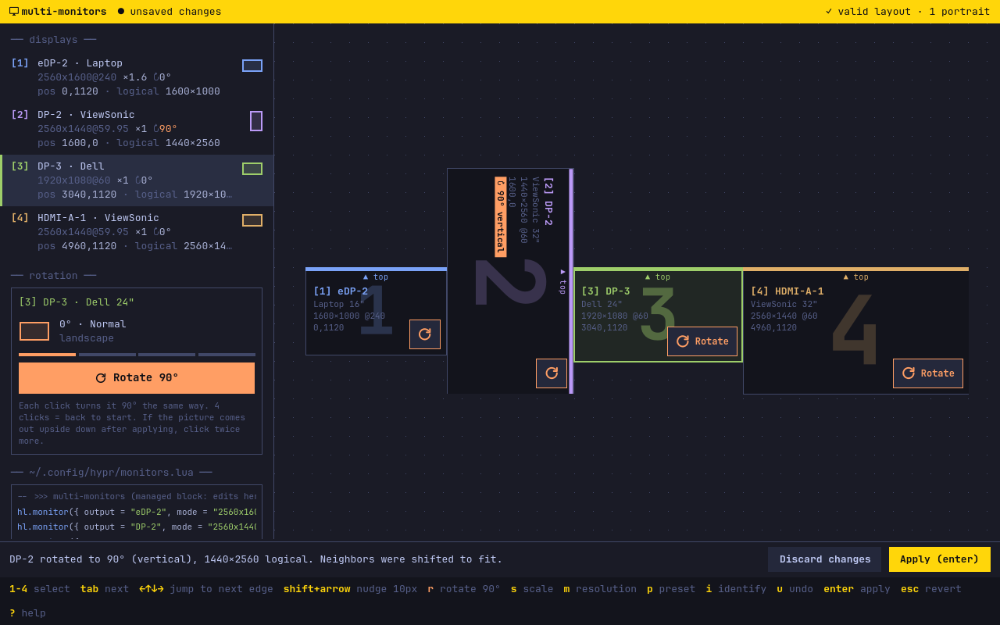

# oma-hypr-screens



Arrange Hyprland's monitors on Omarchy: drag them into place, turn them to
portrait, and pick scale and resolution. The result goes into
`~/.config/hypr/monitors.lua`, with a few seconds to keep or revert it.

- Displays snap to each other's edges, with guides; hold Alt to move freely.
  A display dropped where it touches nobody is pulled to the nearest one, and
  overlapping displays turn red and block Apply.
- Every display has a Rotate button. Each click turns it 90°, always the same
  way, and the neighbors move so nothing overlaps or floats.
- Selecting a display shows every monitor's number on the monitor itself, with
  the selected one highlighted, so you know which is which.
- Any display can be turned off (`O`, or the button under Rotate) and back on.
  An off display leaves the canvas and is written as `disabled = true`;
  Hyprland moves its workspaces to the others. The last display that is on
  stays on.

## Saving

The canvas is a draft until you Apply. Apply copies `monitors.lua` to
`monitors.lua.bak`, rewrites only the block between
`-- >>> oma-hypr-screens` and `-- <<< oma-hypr-screens` (the first time, it comments
out the catch-all `hl.monitor({ output = "" … })` rule and puts the block where
it was), keeps everything else, and reloads Hyprland. Then you have 10 seconds
to Keep it; Revert, or no answer, puts the previous file back and your
screens with it, while the canvas keeps the draft you applied so you can fix
it and apply again (`Esc` once more discards it). If Hyprland
reports a config error, the previous file comes back right away.

Rules name each display by its description (make, model and serial), as in
`output = "desc:Dell Inc. DELL P2422HE 2Z7LYB3"`, not by its connector.
Connector names like `DP-2` can swap between boots when monitors hang off a
dock or a USB-C hub, and a rule for a connector that changed lands on the
wrong display or on none. Two identical displays without a serial can't be
told apart that way, so they fall back to their connectors. A comment after
each rule says which connector the display has today.

## Keys

| Key | Action |
| --- | --- |
| `1`–`9` | Select a display (its number lights up on every monitor) |
| `Tab` | Next display |
| `←` `↑` `↓` `→` | Jump to the next edge |
| `Shift` + arrow | Nudge 10 px |
| `R` | Rotate 90°, always the same way |
| `S` | Next scale |
| `M` | Next resolution |
| `P` | Next preset |
| `O` | Turn the display off, or back on |
| `I` | Show every number on the monitors |
| `U`, `Ctrl+Z` | Undo |
| `Ctrl+Shift+Z` | Redo |
| `Enter`, `Space` | Apply; `Enter` again keeps it |
| `Esc` | Revert (the draft stays), or discard the changes |
| `Alt` + drag | Move without snapping |
| `?` | Help |
| `Q` | Quit (asks first with unsaved or unconfirmed changes) |

## Commands

```sh
oma-hypr-screens                    # the window
oma-hypr-screens list [--json]      # the monitors Hyprland has now
oma-hypr-screens lua                # the managed block for the current layout
oma-hypr-screens identify [OUTPUT]  # show each monitor's number on it
```

They only read; changing the layout goes through the window, where you confirm
the result on your screens.

## Build

```sh
bin/build     # build/oma-hypr-screens
bin/test      # Qt Test, offscreen; never touches your real config
bin/install   # makepkg, then pacman -U (sudo, or pkexec without a terminal)
```

Needs `qt6-base`, `qt6-declarative`, `qt6-wayland`, and `layer-shell-qt`, which
draws the numbers on each screen.
